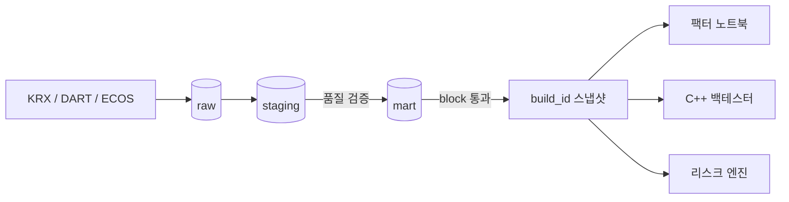

# kr-quant-data-pipeline

ECOS, OpenDART, KRX 데이터를 자동 수집·검증·적재해 **look-ahead bias와 생존편향을 통제한 퀀트 리서치용 일별 데이터셋**을 만드는 파이프라인입니다.

| 항목 | 내용 |
|---|---|
| 목표 | 그 시점에 알 수 있었던 데이터만 조회되는 point-in-time 데이터셋 |
| 데이터 | KRX(일별 시세, 종목 정보), OpenDART(공시, 재무), ECOS(거시), KRX 상장폐지 목록(수동 파일) |
| 스택 | Python 3.12, Airflow 3.3, PostgreSQL 16, Parquet, Docker Compose |
| 사용처 | 팩터 리서치, C++ 백테스팅 엔진, VaR/ES 리스크 엔진 |

## 핵심 설계

- **시간 규약**: 대상, 공개, 사용 가능, 관측, 기준 시점을 분리합니다. 재무는 공시 다음 개장일부터 조회됩니다.
- **생존편향 방지**: 폐지 종목을 보존하고, 공식 목록과 대조하며, 폐지 수익률까지 수익률 계열에 반영합니다.
- **수정주가**: 수익률은 저장하고, 수정 종가는 기준 시점별로 계산합니다.
- **불변 raw**: 응답 내용은 바꾸지 않고, 관측 이력으로 소스 정정을 감지합니다.
- **차단형 품질 검증**: block 규칙을 통과한 빌드만 발행합니다.
- **재현 가능한 서빙**: 사용처는 `build_id`가 붙은 불변 Parquet 스냅샷을 읽습니다.

## 아키텍처

## 실행 방법

> TODO: v0.1.0 완료 시 실제 동작을 확인한 명령으로 채웁니다.

## 마일스톤

| 버전 | 범위 | 상태 |
|---|---|---|
| v0.1.0 | Docker 환경, DB 스키마, KRX 시세 수집 DAG | 진행 예정 |
| v0.2.0 | ECOS, DART 수집, 증분 적재 | 예정 |
| v0.3.0 | staging 변환, 거래일 달력, 품질 검증 | 예정 |
| v0.4.0 | 종목 마스터, 폐지 처리, 수정주가, PIT 재무, PIT 거시 | 예정 |
| v1.0.0 | 팩터 테이블, 팩터 분석 노트북, 서빙 스냅샷 | 예정 |

## 데이터 이용 고지

이 레포는 코드만 공개하며 원천 데이터를 포함하지 않습니다. 각 데이터의 이용 조건은 제공처 약관을 따릅니다.

- 출처 표기 문구: TODO (G0-2 확인 후 확정. 후보: "한국거래소 통계정보")
- 투자 조언이 아니며, 데이터의 정확성을 보장하지 않습니다.

## 개발 규칙

- GitHub Flow: `main`은 항상 동작하며, `feat/*`, `fix/*` 브랜치에서 작업 후 PR로 머지합니다.
- 커밋은 Conventional Commits를 따릅니다.
- 마일스톤마다 버전 태그를 붙입니다.
- API 키는 `.env`로 관리하며 커밋하지 않습니다.
