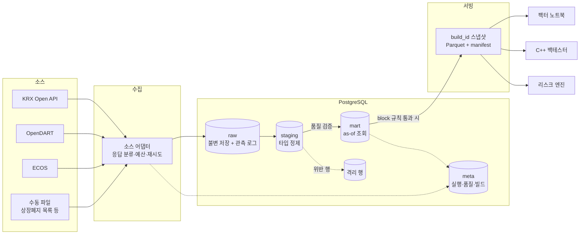

# 0. 아키텍처 명세

`docs/00-architecture.md`. 다른 문서가 이 장과 충돌하면 이 장이 우선합니다.

## 0.1 목표와 비목표

| 구분 | 내용 |
|---|---|
| 목표 | T일 장 마감까지 알 수 있었던 사실만으로 T일 신호를 재현할 수 있는 일별 데이터셋 |
| 사용처 | 팩터 리서치, C++ 백테스터, VaR/ES 엔진 |
| 규모 | 1~2인, 단일 머신. 종목 약 2,800개, 일별 시세 약 1,170만 행 |
| 비목표 | 실시간 체결, 틱 저장, 주문 실행, 데이터 재배포 |

| 운영 목표 | 기준 |
|---|---|
| 일별 발행 | 개장일 08:45 전 (KRX 08:00 갱신 전제, G1-12에서 실측) |
| 누락 | 개장일 raw 누락 0건. 누락이 있으면 빌드 차단 |
| 재현성 | 같은 raw에서 다시 만든 mart의 지문이 동일 (ID가 아닌 자연키 기준) |
| 복구 | 최신 백업으로 복원 후 mart 재생성 1일 이내 |

## 0.2 데이터 흐름



쓰기 경로는 왼쪽에서 오른쪽 한 방향입니다. 사용처는 PostgreSQL이 아니라 발행된 스냅샷을 읽습니다.

## 0.3 시간 규약

모든 look-ahead 방지 규칙은 아래 다섯 시점의 구분에서 나옵니다.

| 시점 | 컬럼 | 의미 |
|---|---|---|
| 대상 시점 | `trade_date`, `period_end`, `obs_period_end` | 데이터가 설명하는 날짜나 기간 |
| 공개 시점 | `rcept_dt`, `release_date` | 시장에 공개된 날 |
| 사용 가능 시점 | `available_from`, `known_from` | 리서치가 쓸 수 있는 첫 개장일 |
| 관측 시점 | `fetched_at`, `first_seen_at` | 파이프라인이 실제로 받은 시각 |
| 기준 시점 | `p_as_of` | 쿼리가 서 있는 날 |

**신호·체결 규약 (전 사용처 공통)**

| 항목 | 규칙 |
|---|---|
| 신호 입력 | `signal_date = T`는 T일 시세와 `available_from <= T`인 값만 사용 |
| 체결 | 기본 T의 다음 개장일 시가. T일 종가 체결 백테스트 금지 |
| 근거 | KRX API는 T일 시세를 다음 영업일 오전에 제공합니다. 라이브에서 T일 종가로 체결할 수 없습니다 |
| 공시 | `rcept_dt` 다음 개장일부터 사용. 접수 시각을 알 수 없어 장전 공시도 같은 규칙을 적용합니다 |
| 달력 | 날짜 계산은 `mart.fn_next_open`, `mart.fn_prev_open`만 사용. `+ 1 day` 금지 |

## 0.4 수집 계층

### 주기와 소스

| 티어 | 주기 | 소스 | 방식 | 상태 | 저장 위치 |
|---|---|---|---|---|---|
| T1 | 일별 EOD | KRX Open API | REST 배치 | v0.1.0 | PostgreSQL → Parquet |
| T2 | 공시 발생 | OpenDART | REST 배치, 일 2회 | v0.2.0 | PostgreSQL |
| T3 | 일·월·분기·연 | ECOS | REST 배치 | v0.2.0 | PostgreSQL |
| T4 | 분봉 | 미정 (증권사 API 등) | REST 배치 | 설계만, 선택 | Parquet |
| T5 | 틱·호가 | 미정 (증권사 WebSocket, KRX 유료) | 스트림 | 설계만, 범위 밖 | Parquet |

**틱·분봉은 이 프로젝트의 세 소스로 구할 수 없습니다.** KRX Open API는 공개 구현 기준 일별 데이터만 제공합니다. T4·T5는 소스 결정이 먼저이고, 지금은 아래 인터페이스만 고정해 나중에 추가해도 raw 이후 계층이 바뀌지 않게 합니다.

### 소스 어댑터 계약

```python
# src/quantdata/ingest/contract.py
class Outcome(StrEnum):
    SUCCESS = "success"; EMPTY = "empty"; NOT_READY = "not_ready"
    TRANSIENT = "transient"; QUOTA = "quota"; AUTH = "auth"
    BAD_REQUEST = "bad_request"; SCHEMA = "schema"

class BatchSource(Protocol):                  # T1~T4
    source: str
    def plan(self, scope: Scope) -> Iterable[RequestSpec]: ...   # 요청 목록. 호출 없음
    def fetch(self, req: RequestSpec) -> RawResponse: ...        # 호출 1회. 해석 없음
    def classify(self, res: RawResponse) -> Outcome: ...         # 본문까지 보고 판정
    def canonicalize(self, res: RawResponse) -> Canonical: ...   # 해시 대상 정규화

class StreamSource(Protocol):                 # T5
    source: str
    def subscribe(self, symbols: list[str]) -> AsyncIterator[Event]: ...
    def resync(self, symbol: str, since_seq: int) -> Iterable[Event]: ...

@dataclass(frozen=True)
class Event:                                  # 스트림 공통 봉투
    source: str; venue: str; symbol: str
    event_ts: datetime; recv_ts: datetime; seq: int; kind: str; payload: dict
```

스트림은 Airflow 태스크로 돌리지 않습니다. 별도 상시 컨테이너가 날짜·거래소별 append-only 로그를 쓰고, Airflow는 마감 후 압축과 검증만 합니다. 중복 키는 `(venue, symbol, seq)`, 공백 탐지는 `seq` 연속성, 재연결 후 복구는 `resync`입니다. KRX와 NXT 체결은 `venue`로 구분합니다.

### 응답 분류표

HTTP 200이 성공을 뜻하지 않습니다. DART와 ECOS는 오류도 200으로 보내므로 **본문까지 판정한 뒤에만** 저장 결과를 `success`로 기록합니다. 코드 표는 공개 구현 기준이며 G0에서 확정합니다.

| 결과 | KRX | DART | ECOS |
|---|---|---|---|
| `success` | `OutBlock_1` 행 있음 | `status=000` | 서비스 키에 `row` 있음, `list_total_count` 일치 |
| `empty` | 행 없음 + 달력상 휴장 | `013` (필수 공시가 없는 요청에 한함) | `INFO-200` |
| `not_ready` | 행 없음 + 개장일 | 공시는 있는데 `013`, 또는 `014` | 없음 |
| `transient` | 5xx, 타임아웃, 비JSON 200 | 5xx, `800`, `900` | `ERROR-500`, `ERROR-600` |
| `quota` | 429 | `020` | `ERROR-602` |
| `auth` | 401, 403, 미승인 `respCode` | `010`, `011`, `012`, `101`, `901` | `INFO-100` |
| `bad_request` | 파라미터 오류 | `021`, `100` | `ERROR-100/101/200/300/301/601` |
| `schema` | 블록 수 이상, 필수 필드 없음 | 필수 필드 없음, zip 자리에 XML | 필수 필드 없음 |

| 결과 | 재시도 | 후속 조치 |
|---|---|---|
| `not_ready` | Sensor `reschedule` 5분 간격, 최대 3시간 | 소진 시 실패. 다음 날 성공으로 가리지 않음 |
| `transient` | 지수 백오프 2→60초, 지터, 최대 5회. `Retry-After` 우선 | 소진 시 실패 |
| `quota` | 재시도 금지 | 해당 소스 당일 중단, 다음 날 재개 |
| `auth` | 재시도 금지 | DAG 즉시 실패 |
| `bad_request` | 재시도 금지 | `021`은 배치 분할, `ERROR-400`은 기간 분할 후 새 요청 |
| `schema` | 재시도 금지 | 본문을 raw에 보존하고 `failed` 기록. 파서 수정 필요 |

### 호출 제어

| 항목 | KRX | DART | ECOS |
|---|---|---|---|
| 일 예산 (`soft_limit`) | 8,000 | 16,000 (G0 확정 전 8,000) | 800 |
| 분당 상한 | 60 | 600 | 80 |
| 동시 태스크 (pool) | 2 | 4 | 2 |
| 초기화 기준 | KST 자정 (G0 확인) | KST 자정 (G0 확인) | G0 확인 |

- 예산은 호출 **직전에** `meta.fn_reserve_quota`로 예약합니다. 재시도도 1회로 셉니다. 백필은 `p_share=0.7`로 호출해 일별 수집 몫을 남깁니다.
- 일 예산과 분당 상한은 공개 한도보다 낮게 잡은 초기값입니다. 호출 제한 수치는 코드에 넣지 않고 `meta.api_quota_policy`와 `conf/sources.yaml`에 둡니다.

### 수집 대상 선정

성공한 요청을 영원히 건너뛰면 소스의 정정을 볼 수 없습니다. 대상을 세 모드로 나눕니다.

| 모드 | 대상 | 주기 |
|---|---|---|
| `new` | `success`, `empty` 기록이 없는 `request_key` | 매일 |
| `recheck` | KRX 최근 5개장일, DART `list.json` 최근 14일 (`rm` 변화 감지), ECOS 시리즈 전체 | KRX·ECOS 주 1회, DART 매일 |
| `backfill` | 과거 구간. 남은 예산 안에서만 실행하고 다음 날 이어감 | 매일 00:30 |

### 해시 규칙

| 대상 | 규칙 |
|---|---|
| JSON | 키 정렬, UTF-8, 공백 없는 구분자. `conf/sources.yaml`의 변동 필드 제거 후 SHA-256 |
| zip (`corpCode.xml`, XBRL) | zip 바이트가 아니라 **압축 해제한 멤버** 이름순 해시. zip 바이트 해시는 내용이 같아도 타임스탬프로 달라집니다 |
| NUL 문자 | `jsonb`는 `\u0000`을 거부합니다. 제거하고 원문은 `blob_path`로 보존 |

## 0.5 처리 계층

### 결측 정책

| 데이터 | 상황 | 처리 | 금지 |
|---|---|---|---|
| 시세 | 개장일 응답에 종목 없음 | 행을 만들지 않고 R-CP-02로 경고 | 전일 행 복사 |
| 시세 | 거래 없음 | 행 유지, OHLC NULL, `volume=0`. 종가가 0이면 직전 종가 사용 | OHLC 0 저장 |
| 시세 | 거래대금·시총 NULL | NULL 유지 | 0 대입 |
| 재무 | 계정 없음 | NULL | 0 대입, 전기 값 이월 |
| 재무 | TTM 구성 값 부족 | 해당 종목 제외 | 부분합 |
| 거시 | 공표 전 | as-of 조회로 직전 공표값 사용 | 대상 기간 조인 |
| 팩터 | 입력 NULL | 팩터 NULL, 커버리지 리포트 | 평균 대치 |

대치는 mart에서 하지 않습니다. 필요하면 리서치 코드에서 하고 방법을 기록합니다.

### 이상치 3단계

| 단계 | 대상 | 예 | 조치 |
|---|---|---|---|
| 1. 불가능한 값 | 물리적으로 성립하지 않음 | 고가 < 저가, 종가 0, 코드 형식 위반 | `meta.quarantine_row`로 격리. 비율 초과 시 빌드 차단 |
| 2. 제도 위반 | 그날 규정으로 불가능 | 가격제한폭 초과 (상장 첫날, 정리매매 제외) | 경고 후 원인 확인 |
| 3. 통계적 이상 | 드물지만 가능 | MAD 기준 극단값, 거래량 급증 | 경고만. **값을 고치지 않음** |

Winsorize는 팩터 계산 단계에서만 합니다. 규칙과 임계값은 [품질 규칙 카탈로그](08-data-quality.md)에 있습니다.

### 생존편향 방지 체인

한 단계만 빠져도 편향이 남습니다.

| 단계 | 조치 | 검증 |
|---|---|---|
| 1. 시세 | 과거 `basDd` 응답에 이후 폐지 종목이 포함되는지 확인 | G1-1 |
| 2. 종목 마스터 | 폐지 종목을 삭제하지 않고 내부 `security_id` 유지 | 회귀 테스트 |
| 3. 공식 대조 | KRX 상장폐지 목록과 연도별 건수 대조 | R-SB-01 |
| 4. 재무 연결 | 폐지 회사까지 `corp_code` 연결 | R-SB-02 (폐지 코호트 별도 집계) |
| 5. 폐지 수익률 | 마지막 거래 이후 손실을 수익률에 반영 | R-SB-03 |
| 6. 유니버스 | T일 값으로만 필터링. 현재 지수 구성종목으로 과거를 고르지 않음 | R-PIT-02 |

**재무 연결 순서**: `corpCode.xml`의 `stock_code` → 공시의 `stock_code` → 금융위 KRX상장종목정보의 법인등록번호와 DART `company.json`의 `jurir_no` 대조 → 수동 매핑. 어떤 경로로 연결했는지 `map_security_corp.method`에 남깁니다.

**이전상장은 상장폐지가 아닙니다.** 코스닥에서 코스피로 옮긴 종목이 KRX 폐지 목록에 나타날 수 있습니다. 코드를 유지하며 다음 개장일에 다른 시장으로 나타나면 `dim_security_history`에 새 행만 추가합니다 (R-SB-04).

**폐지 수익률**: 전부 -100%로 두면 합병 대가를 받은 종목을 과대 손실 처리합니다. 사유별로 처리하고, 가정값은 리서치에서 민감도를 확인합니다.

| 사유 (`reason_group`) | 처리 | `return_basis` |
|---|---|---|
| `distress` + 정리매매 있음 | 정리매매 종가까지 시세로 반영, 추가 손실은 설정값 | `last_close` 또는 `assumed` |
| `distress` + 정리매매 없음 | 설정값 (`delist.distress_return`) | `assumed` |
| `merger_cash` | 공시된 대가 ÷ 마지막 종가 - 1 | `consideration` |
| `merger_stock` | 승계 종목으로 포지션 이전 (`successor_security_id`) | `consideration` |
| `voluntary`, `other`, `unknown` | 마지막 종가, 슬리피지는 백테스터 설정 | `last_close` |

### 수정주가와 수익률

수정 종가는 `as_of`마다 수준이 달라지지만 일별 수익률은 달라지지 않습니다. 그래서 수익률을 저장하고, 수정 종가는 조회 시 계산합니다.

```text
기준가(t)   = 종가(t) - 전일대비(t)
이벤트 후보 : 기준가(t) <> 종가(t-1)        → factor(t) = 기준가(t) / 종가(t-1)
G(t)        = t 이하 ex_date의 factor 누적곱   (fact_daily_price.cum_factor)
ret(t)      = 종가(t) / (종가(t-1) × factor(t)) - 1
adj(t|as_of)= 종가(t) × G(as_of) / G(t)       (t <= as_of)
총수익(t)   = ret(t) + 현금배당(t) / 기준가(t)
```

`G`는 앞쪽부터 쌓이므로 새 이벤트가 생겨도 과거 행을 다시 쓰지 않습니다. 원본처럼 행마다 이벤트를 다시 곱하지 않아 조회 비용이 이벤트 수와 무관합니다.

| 항목 | 규칙 |
|---|---|
| 후보 판정 | 평상시 기준가는 전일 종가와 같으므로 공차 없이 불일치로 판정 (G1-2, G1-11에서 확인) |
| 탐지 후 상태 | `candidate`도 누적곱에 포함합니다. 실제 분할을 빼면 -98% 가짜 수익률이 생기기 때문입니다 |
| 확정 | DART 근거가 붙으면 `confirmed`, 근거가 반증되면 `rejected` |
| 이벤트 유일성 | 종목·ex_date당 1행. 탐지 경로는 `fact_corp_action_evidence`에 누적 |
| 현금배당 | 기준가에 반영되지 않아 `fact_dividend`로 분리 (G1-11에서 확인) |
| 배당락일 | `mart.fn_ex_date(배당기준일)`. 기준일 이하 마지막 개장일의 직전 개장일. T+2 결제 기준이며 T+1 전환 시 규칙 변경 |
| 배당 공시 시점 | 배당액이 배당락 뒤에 확정될 수 있습니다. 총수익 P&L은 ex_date, 신호는 `known_from`을 씁니다 |

검산: 삼성전자 분할 (2018-05-04). `기준가 = 51,900 - (-1,100) = 53,000`, `factor = 53,000 / 2,650,000 = 0.02`. 전일대비는 공개된 등락률로 역산한 값이라 G1-2에서 실측합니다.

### 시장 구조 변화

기간을 넘는 팩터 비교와 이상치 기준에 영향을 줍니다. `conf/market_regimes.yaml`로 관리합니다.

| 시점 | 변화 | 데이터 영향 | 처리 |
|---|---|---|---|
| 2015-06-15 | 가격제한폭 ±15% → ±30% | 일별 변동폭 분포 변화 | R-PX-20 날짜별 한도 |
| 2023-06-26 | 신규상장 첫날 공모가의 60~400% | 첫날 수익률 왜곡 | 상장 첫날 신호 제외 |
| 2023~ | 배당기준일을 배당액 확정 뒤로 정할 수 있게 됨 | 12월 말 배당락 가정 붕괴 | 공시의 기준일 사용 |
| 2023-11-06 ~ 2025-03-30 | 공매도 전면 금지 | 숏 레그 재현 불가 | 백테스터 제약 |
| 2025-03-04 | 넥스트레이드 출범 | KRX 거래량이 시장 전체가 아님. 유동성 지표 단층 | 2025-03-04 전후 분리 분석 |
| 2026-09-14 | KRX 애프터마켓 시작, 시간외 단일가 폐지 | `ACC_TRDVOL` 범위 변경 가능 | G1-8 |

## 0.6 저장과 서빙

### 저장소 선택

| 대안 | 장점 | 단점 | 판단 |
|---|---|---|---|
| **PostgreSQL + Parquet 스냅샷** | 트랜잭션·제약은 PostgreSQL, 대량 읽기는 컬럼 파일 | 스냅샷 생성 단계 필요 | **채택** |
| PostgreSQL 단독 | 구성 단순 | 전체 패널 전송이 병목 | 아래 측정으로 기각 |
| TimescaleDB | 시계열 함수, 압축 | 확장 의존, 일별 1,170만 행에는 과함 | 보류 |
| ClickHouse 등 | 분석 속도 | 트랜잭션·제약 약함, 운영 추가 | 기각 |

### 측정 결과

환경: 2 vCPU, RAM 7GB, PostgreSQL 16.15 (`shared_buffers=1GB`). 합성 데이터 2,800종목 × 4,170일 = 1,167.6만 행, 이벤트 1,500건. 캐시 적재 후 3회 중앙값 (전체 패널은 1회). 실제 데이터 측정이 아닙니다.

| 수정주가 조회 | 원본 설계 | 개정 설계 | 배율 |
|---|---|---|---|
| 1일 단면 (2,800행) | 4.7ms | 2.1ms | 2.2배 |
| 1종목 전체 (4,170행) | 12.3ms | 12.4ms | 동일 |
| 1년 패널 (72.8만 행) | 1.78초 | 0.28초 | 6.4배 |
| 전체 패널 (1,167.6만 행) | 28.7초 | 5.3초 | 5.5배 |

두 설계의 표본 합계는 일치했습니다 (종목 50개 수정 종가 합 4,201,434,060.80).

| 전체 패널 5개 컬럼 읽기 | 시간 | 크기 |
|---|---|---|
| PostgreSQL `COPY TO STDOUT` | 8.7초 | 전송 395MB |
| Parquet → Arrow (`pyarrow`) | 0.32초 | 파일 0.23GB (9개 컬럼, zstd) |
| Arrow IPC 메모리 매핑 열기 | 0.4ms | 0.42GB |

해석: 1일 단면과 1종목 조회는 PostgreSQL로 충분합니다. 병목은 전체 패널 전송이고, 그래서 백테스트와 팩터 계산은 Parquet을 읽습니다.

### 테이블 설계

| 항목 | 결정 | 이유 |
|---|---|---|
| `fact_daily_price` | `trade_date` 연 단위 범위 파티션 | 단면 조회 가지치기, 연 단위 재생성·보관 |
| 인덱스 | PK `(security_id, trade_date)`, 보조 `(trade_date, security_id)` | 종목 시계열, 일자 단면 둘 다 인덱스로 처리 |
| 기본 파티션 | 존재하되 항상 비어 있어야 함 | 연도 파티션 누락 시 R-OPS-01로 실패 |
| `factor_daily` | PostgreSQL에 최근 2개 빌드만 | 팩터 수 × 1,170만 행이 쌓이는 것을 방지 |
| 인덱스 작성 | 대량 적재는 날짜순 삽입 | 일자 범위 스캔의 지역성 유지 |

### 빌드와 발행

```text
data/serving/<build_id>/
├── manifest.json
├── daily_bar/year=2024/*.parquet     # security_id, trade_date, OHLCV, ret_price, ret_total, cum_factor
├── universe/year=2024/*.parquet      # trade_date, security_id, market, security_type
├── security_master.parquet
├── financial_pit/*.parquet
├── macro_pit/*.parquet
└── factor/name=<factor>/year=2024/*.parquet
```

```json
{
  "build_id": "20261030-a1b2c3d",
  "data_cutoff": "2026-10-30",
  "git_sha": "a1b2c3d",
  "schema_version": 1,
  "row_counts": {"daily_bar": 11676000},
  "file_sha256": {"daily_bar/year=2024/part-0.parquet": "..."},
  "dq": {"block_failed": 0, "warn_failed": 3},
  "pit_quality_share": {"observed": 0.0, "single_version": 0.0, "xbrl_original": 0.0, "backfill_latest": 0.0}
}
```

| 규칙 | 내용 |
|---|---|
| 불변 | 발행된 `build_id` 폴더는 수정하지 않습니다. 수정본은 새 `build_id` |
| 발행 | `meta.fn_publish_build`가 block 규칙 통과를 확인하고 `serving_pointer`를 원자적으로 교체 |
| 라이브 분리 | `live`는 매일 전진, `research`는 고정해 두고 수동 전진. 백테스트가 도중에 바뀌지 않음 |
| 재현 | 백테스트 결과에 `build_id`를 함께 기록 |
| C++ 로드 | Parquet을 Arrow로 읽어 사용. 일중 재실행이 잦으면 Arrow IPC로 변환해 메모리 매핑 |

### 라이브 일정 (개장일, KST)

| 시각 | 단계 | 실패 시 |
|---|---|---|
| 07:30 | DART 증분 | 전날 18:30 수집분으로 진행, R-IN-05 경고 |
| 08:20 | KRX 전 거래일 수집 | 미갱신이면 5분 간격 재확인 |
| 08:30 | staging → 품질 검증 → mart | block 위반이면 중단 |
| 08:40 | Parquet 빌드, `live` 포인터 교체 | **직전 빌드 유지**, 사용처는 `data_cutoff`로 지연 인지 |
| 09:00 | 개장 | |

사용처는 시작할 때 `data_cutoff`가 직전 개장일인지 확인하고, 아니면 신호 생성을 멈춥니다.

## 0.7 운영

### DAG 목록

| DAG | 스케줄 (KST) | 내용 | pool |
|---|---|---|---|
| `krx_daily_ingest` | 평일 08:20 | 코스피·코스닥 일별매매, 지수 | `krx_api` |
| `dart_filing_ingest` | 매일 07:30, 18:30 | 공시 목록 증분, `rm` 재확인, 재무 수집 | `dart_api` |
| `ecos_macro_ingest` | 평일 09:30 | 시리즈 증분 | `ecos_api` |
| `daily_build` | KRX Asset 갱신 시 | staging → 검증 → mart → 스냅샷 → 발행 | - |
| `krx_backfill`, `dart_backfill` | 매일 00:30 | 남은 예산만큼 과거 구간 | 소스별 |
| `weekly_recheck` | 토 03:00 | KRX·ECOS 재확인 | 소스별 |

`catchup`은 끕니다. 놓친 날은 `new` 모드 계획이 다음 실행에서 자동으로 잡으므로 Airflow 스케줄과 수집 범위를 분리합니다.

### 백업

`observed` 재무와 관측 이력은 **API로 다시 받을 수 없습니다.** raw는 일반 캐시가 아니라 원본입니다.

| 항목 | 규칙 |
|---|---|
| 방식 | `docker compose --profile ops run --rm backup` (매일 04:00, 호스트 cron) |
| 위치 | Docker 볼륨 밖 `BACKUP_DIR`. 가능하면 다른 디스크 |
| 보관 | 일 7개, 주 4개 |
| 검증 | 생성 시 `pg_restore --list`, 분기 1회 실제 복원 |
| 감시 | 마지막 백업이 7일을 넘으면 R-OPS-02 실패 |

### 장애 대응

| 증상 | 확인 | 조치 |
|---|---|---|
| 개장일 KRX 빈 응답 | 지수 응답, 갱신 시각 | `not_ready` 재시도. 3시간 초과면 실패로 남기고 다음 날 `new`가 재수집 |
| `quota` 실패 | `meta.api_quota_usage`, 소스 이용 현황 | 당일 중단. `soft_limit` 재검토 |
| `running`이 멈춤 | `meta.v_pipeline_health.stale_running` | 태스크 시작 시 하트비트 15분 초과 건을 `failed(transient)`로 정리 후 재시도 |
| 파서 `schema` 실패 | raw 본문의 필드 차이 | 파서 수정 후 raw에서 재처리. 재호출 불필요 |
| 격리 행 급증 | `meta.quarantine_row` 규칙별 건수 | 비율 초과 시 빌드 차단 유지, 원인 수정 후 `released` 처리 |
| 소스 정정 감지 | `raw.v_revision` | 해당 날짜 staging과 mart 재생성 |
